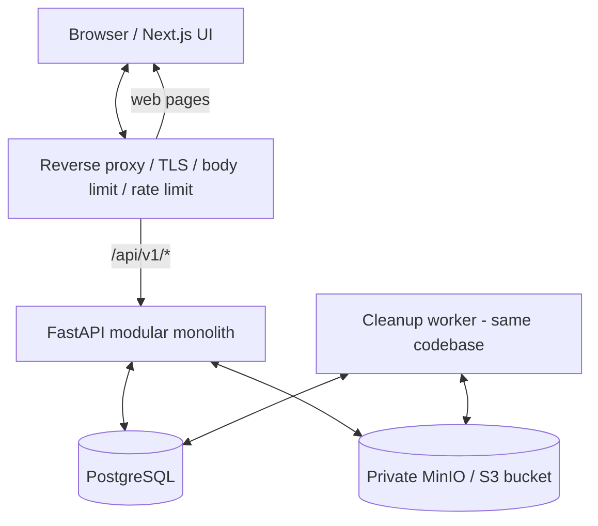
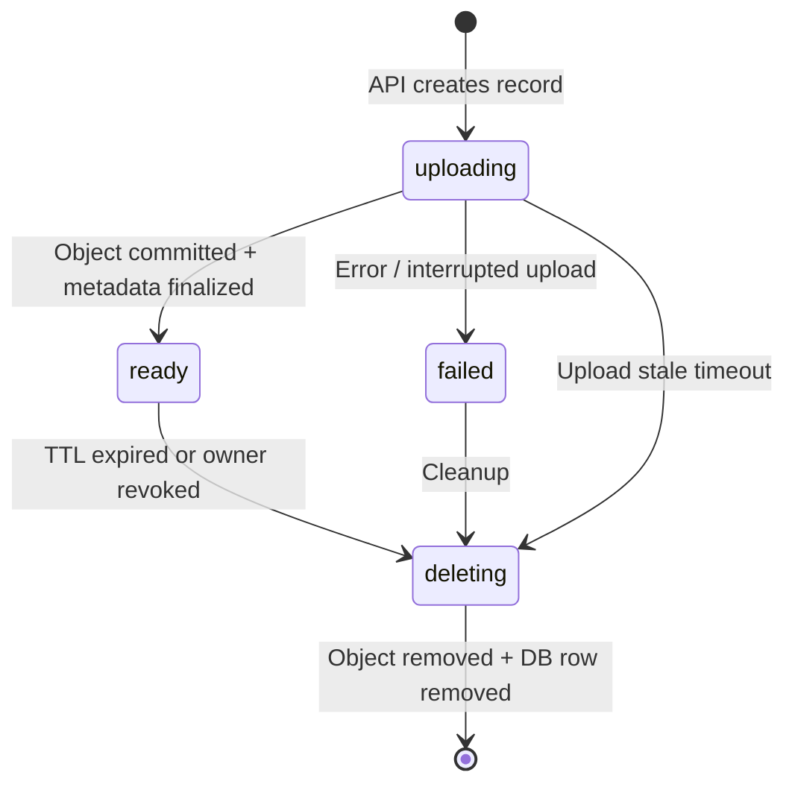

# Sendrift — architecture v0.1

**Status:** Proposed for MVP · **Pattern:** modular monolith · **Date:** 2026-10-11

## 1. Цели и решения

Sendrift передаёт файл по секретной ссылке. Успех означает, что файл действительно хранится в приватном storage, ссылка работает до конца TTL, а доступ после истечения блокируется независимо от расписания очистки.

**Выбранная архитектура:** UI и API развернуты отдельно, но вся серверная бизнес-логика находится в **одном FastAPI-приложении**. Отдельный фоновый worker использует тот же код и ту же БД. Это не набор независимых микросервисов.

**Сознательный компромисс MVP:** передача файлов идёт через API, а не напрямую из браузера в S3. Это упрощает контроль доступа и отказов при размере до 100 MiB, но увеличивает трафик и нагрузку на API. При реальной нагрузке архитектуру можно пересмотреть.

## 2. Component diagram



Примечание: на диаграмме `Next.js UI` обозначает web-приложение, а `Browser` — его пользовательский клиент. Production proxy проксирует браузерные запросы к Next.js и FastAPI по разным путям одного origin. MinIO и PostgreSQL не доступны из публичной сети.

### Зоны ответственности

| Компонент | Отвечает за | Не отвечает за |
| --- | --- | --- |
| Next.js | UX, выбор файла, прогресс, копирование ссылки, сообщения об ошибках | Выдача доступа, секреты S3, лимиты, бизнес-правила |
| FastAPI | Правила TTL/размера, создание токенов, права доступа, загрузка и скачивание | Долговременное хранение больших бинарных данных в БД |
| PostgreSQL | Метаданные и жизненный цикл записи, хеши токенов | Байты файла |
| MinIO/S3 | Приватное хранение бинарных объектов | Решение, кому и сколько раз разрешено скачивание |
| Cleanup worker | Идемпотентное удаление просроченных/зависших загрузок и восстановление после ошибок | Выдача пользователю доступа |
| Reverse proxy | HTTPS, ограничение тела HTTP-запроса, базовая защита от abuse | Смысловая авторизация ссылок |

## 3. API modules (один процесс/проект)

```text
apps/api/
  app/
    main.py
    core/           # settings, structured logging, errors
    api/v1/         # upload, share metadata, download, delete
    schemas/        # Pydantic input/output
    models/         # SQLAlchemy tables/enums
    repositories/   # DB queries and transactions
    services/       # application use cases
    storage/        # S3 adapter / object streaming
    worker/         # cleanup command
  migrations/       # Alembic
  tests/
```

Публичный API не должен зависеть от конкретного клиента S3. `StorageAdapter` имеет узкие операции `put_stream`, `get_stream`, `delete`, `exists/head` по необходимости. Не создавать универсальный фреймворк хранилищ.

## 4. Модель данных

Одна таблица `shares` достаточна для MVP.

| Поле | Тип | Значение |
| --- | --- | --- |
| `id` | UUID PK | Внутренний идентификатор |
| `share_token_hash` | CHAR(64), unique, not null | SHA-256 от секретной публичной ссылки |
| `manage_token_hash` | CHAR(64), not null | SHA-256 от отдельного секрета управления |
| `object_key` | TEXT, unique, not null | Случайный ключ объекта в приватном bucket |
| `original_filename` | TEXT, not null | Отображается как данные, не путь |
| `content_type` | TEXT, nullable | Подсказка от клиента, не доверенная классификация |
| `size_bytes` | BIGINT, nullable | Фактически проверенный размер, > 0 только для ready |
| `ttl_seconds` | INT, not null | Одно из 3600 / 86400 / 604800 |
| `status` | ENUM | `uploading`, `ready`, `failed`, `deleting` |
| `created_at` | TIMESTAMPTZ | Начало обработки |
| `ready_at` | TIMESTAMPTZ, nullable | Когда запись стала доступна |
| `expires_at` | TIMESTAMPTZ, nullable | `ready_at + ttl_seconds` |
| `download_count` | BIGINT, default 0 | Число начатых загрузок через API, не завершённых передач |
| `updated_at` | TIMESTAMPTZ | Для recovery и cleanup |

Ограничения: допустимые значения TTL, `size_bytes` между 1 и 104857600 для `ready`, уникальные hashes/key; `ready` подразумевает `ready_at`, `expires_at` и `size_bytes`. Срок всегда сравнивается по UTC на сервере.

**Почему хеши:** токены обладают >= 256 битами энтропии. Простого SHA-256 достаточно для хранения высокоэнтропийных токенов; пароли людей, если появятся позднее, требуют другого подхода (Argon2id и т.п.). Секреты генерируются сервером через криптографически стойкий CSPRNG.

**Почему не хранить удалённые записи вечно:** после успешной очистки удалить запись вместе с персональными метаданными. Потерянную ссылку после удаления обслуживать как `404`.

## 5. HTTP API v1

Базовый префикс: `/api/v1`. Версионирование фиксируется с начала разработки.

### `POST /shares`

`multipart/form-data`:

- `file`: ровно один файл (1–100 MiB).
- `ttl`: `1h` | `24h` | `7d`.

Успех `201`:

```json
{
  "share_url": "https://<your-host>/s/<share-token>",
  "manage_token": "<separate-manage-secret>",
  "filename": "example.pdf",
  "size_bytes": 12345,
  "expires_at": "2026-10-12T12:00:00Z"
}
```

Выдача `manage_token` только один раз. **Хранить/передавать его отдельно от `share_url`**. Frontend может удерживать его в рамках текущей клиентской сессии; восстановление удалённого секрета не предусмотрено. Не класть `manage_token` в URL, localStorage и стороннюю аналитику.

Ошибки: `400` некорректная форма/TTL, `413` превышен размер, `429` ограничение частоты, `503` временно недоступно storage или другая серверная зависимость. Для сбоя DB/storage внутренние причины только в очищенных логах.

### `GET /shares/{share_token}`

`200`:

```json
{
  "filename": "example.pdf",
  "size_bytes": 12345,
  "expires_at": "2026-10-12T12:00:00Z"
}
```

Не возвращает `object_key`, внутренний `id`, `manage_token` и storage URL. Не увеличивает счётчик скачиваний. Неизвестные, удалённые и истёкшие ссылки → `404`.

### `GET /shares/{share_token}/download`

Авторизация по токену + `status=ready` + проверка UTC `expires_at > now`. При успехе отправлять байты потоком (`StreamingResponse` или эквивалент), `Content-Disposition: attachment` с безопасным экранированием имени, `Content-Type: application/octet-stream`, `X-Content-Type-Options: nosniff`, `Cache-Control: no-store`, `Referrer-Policy: no-referrer`.

`download_count` означает **начатую сервером передачу**, а не гарантированно полностью скачанный файл. Метрика не выставляется в публичном UI. Нет одноразового режима в MVP. Запросы `HEAD` и предварительное получение метаданных не инициируют скачивание.

### `DELETE /shares/{share_token}`

Заголовок: `X-Manage-Token: <secret>`.

Проверить hash share token и hash manage token. Перевести запись в `deleting`: с этого момента дальнейшие скачивания заблокированы. Физическое удаление выполняется worker; повторное удаление должно быть безопасно. Успех `202 Accepted` означает «доступ отозван, удаление запланировано», **не** «байты уже удалены». Неизвестный/неправильный секрет → `404` без раскрытия подробностей.

`/health/live` и `/health/ready` — отдельные технические endpoints, readiness проверяет существенные зависимости без утечки секретов.

## 6. Жизненный цикл файла



### Загрузка

1. Reverse proxy отвергает слишком большое тело запроса до обработки в Python; FastAPI дополнительно проверяет фактический размер.
2. API валидирует единственный файл/TTL и создаёт запись `uploading`, генерирует два независимых 256-битных секрета и случайный `object_key`.
3. Парсер `UploadFile` FastAPI использует spool-to-disk. **Не читать** весь файл через `await file.read()` без параметра. Библиотека записи объекта читает поток ограниченными порциями и подтверждает результат; при использовании блокирующего S3 SDK запускать операцию в threadpool.
4. При ошибке лимита или storage → состояние `failed`/компенсирующее удаление; cleanup восстанавливает после аварии, включая orphan objects по `object_key` в незавершённых записях.
5. После подтверждения `put` в storage выполнить DB transaction `uploading → ready`, установить `ready_at = now UTC` и `expires_at`.
6. Лишь после DB commit вернуть `201` и секреты. Если commit упал, объект остаётся приватным и подлежит recovery; ссылку **не** выдавать как рабочую.

После создания `uploading` API удерживает блокировку строки `FOR UPDATE` на время записи в S3 и до финализации. Cleanup пропускает эту строку через `SKIP LOCKED`, даже если загрузка длится дольше stale timeout. Финализация и отметка ошибки допускаются только из `uploading`; отмена запроса дожидается завершения блокирующего S3 thread перед освобождением блокировки/временного файла.

Важно: FastAPI `UploadFile` уже может буферизовать тело запроса в память/временный диск. Поэтому размер HTTP тела, количество multipart полей, свободное место в tmp и таймауты также ограничены. `Content-Length` клиента недостаточен для валидации.

### Просмотр и скачивание

1. Web открывает `/s/<token>` и вызывает endpoint метаданных.
2. Endpoint не возвращает ничего про файл, если токен неверный, статус не `ready` или срок истёк.
3. Нажатие «Скачать» обращается к отдельному streaming endpoint.
4. API заново проверяет доступ прямо перед началом передачи и читает объект из закрытого bucket.
5. Запись о начале скачивания допускается после успешной проверки доступа; обрыв клиента не трактуется как завершённая загрузка.

**Конкурентное удаление:** передача, начатая непосредственно перед истечением срока/отзывом, может оборваться при физической очистке объекта. Для MVP это задокументированное ограничение. При требовании гарантировать завершение начатых передач потребуется учёт активных download leases и задержка удаления.

### Cleanup / recovery

- Worker запускается отдельно (например, контейнер, проверяющий задачи раз в минуту).
- Выбирает истёкшие `ready`, `deleting`, достаточно старые `failed` и зависшие `uploading`.
- Атомарно переводит подходящие записи в `deleting` (пакетная блокировка/`FOR UPDATE SKIP LOCKED` при нескольких worker), удаляет объект из S3, после подтверждения удаляет строку DB.
- Commit перехода в `deleting` освобождает блокировку: worker повторно захватывает строку с `SKIP LOCKED` и удерживает её до завершения S3 delete и DB delete/commit. После crash остаётся `deleting`; другой worker может безопасно повторить удаление. Stale timeout и grace period отсчитываются от `updated_at`, не `created_at`.
- При ошибке удаления сохраняет `deleting`, повторяет с backoff. Зависшие `deleting` всегда доступны recovery.
- Повторное удаление отсутствующего объекта считается успешным завершением.
- Перед удалением объекта storage adapter прерывает незавершённые multipart uploads с этим точным ключом. Для этого S3 credentials должны разрешать `ListBucketMultipartUploads` и `AbortMultipartUpload`. Reconciliation также проверяет старые multipart uploads без DB записей; недавние и связанные с активной записью сохраняются. Ошибка удаления отдельного ключа оставляет `deleting` и не блокирует остальные записи текущего ограниченного пакета.
- Дополнительно нужен редкий audit/reconciliation для объектов с отсутствующими записями (например, crash после S3 put, но до commit/создания DB ссылки).
- Reconciliation проходит все страницы S3 ограниченными пакетами, пропускает объекты моложе grace period (по умолчанию stale upload timeout) и повторно проверяет отсутствие DB записи перед удалением. API сохраняет DB запись до записи S3, а ключи не переиспользуются; отсутствие строки нельзя считать признаком orphan, используя только устаревший снимок.
- Срок доступа проверяется API, поэтому задержка worker **не** продлевает публичную ссылку.

## 7. Security model

### Основные риски

| Угроза | Защита |
| --- | --- |
| Угадывание share URLs | >=256-bit random secret, SHA-256 в БД, rate limit, никакого перечисления |
| Кража токена через логи/referrer | redaction path/token, `Referrer-Policy: no-referrer`, `Cache-Control: no-store`, без сторонней аналитики на share page |
| Доступ напрямую к storage | приватный bucket, серверные credentials, нет публичной политики |
| Path traversal / XSS от имени | случайный object key, имя только как данные, HTML-escaping, безопасный `Content-Disposition` |
| HTML/SVG execution | всегда `attachment`, `application/octet-stream`, `nosniff`, не рендерить предпросмотр |
| Resource exhaustion | limit 100 MiB + proxy limit, multipart constraints, timeouts, rate/quota на общих ресурсах |
| DDoS/abuse/illegal files | на публичном окружении отдельные лимиты и антиабьюз, приём жалоб, политика удаления, сканирование/контроль риска |
| Непредвиденное раскрытие | Secrets not in logs/DB plaintext; TLS; production configs |
| Stale/expired records | UTC server checks + idempotent worker, no blind trust in cron |

Сервис **не обладает сквозным шифрованием**. Администратор storage с достаточными правами потенциально может видеть байты файла. Не рекламировать хранение как конфиденциальное в криптографическом смысле.

### Лимиты и публичная эксплуатация

- `100 MiB` — логический предел файла, а предел HTTP тела у proxy чуть выше из-за multipart overhead.
- На уровне gateway: rate limiting upload и download, concurrency limits, timeouts, запрет чрезмерно больших request bodies.
- На уровне backend: квоты с учётом общих данных, а не памяти отдельного процесса; лимиты одновременных передач.
- Для **публичного** анонимного сервиса обязательно решить: malware scanning/quarantine до выдачи ссылок, правообладательские и abuse complaints, условия использования, удаление по жалобам, контроль storage/egress bills и оповещения о расходах.
- Пока этих мер нет, деплой ограничить локальным/приватным тестовым окружением.

## 8. Deploy topology

**Local development**: Docker Compose: `web`, `api`, `postgres`, `minio`, `worker`, опционально `proxy`. Бакет создаётся локальной командой и остаётся приватным. `.env.example` содержит лишь вымышленные значения. Реальный `.env` в `.gitignore`.

Next.js проксирует `/api/*` и `/health/*` в FastAPI. `INTERNAL_API_URL` — серверный
адрес, фиксируемый при `next build`: Compose передаёт build argument
`http://api:8000`; вне Docker используется `http://localhost:8000` по умолчанию
(override в `apps/web/.env.local`). Изменение только runtime environment готового
standalone image не меняет rewrites: образ необходимо пересобрать. Браузер по
умолчанию использует тот же origin; необязательный `NEXT_PUBLIC_API_URL` — отдельный
публичный адрес, также фиксируемый при сборке JS, а не внутренний Docker hostname.

API формирует публичные ссылки и redirects из настроенного `PUBLIC_WEB_URL`
(по умолчанию `http://localhost:3000`, в production — реальный HTTPS origin).
Заголовки `Host`, `X-Forwarded-Host`, `X-Forwarded-Proto` и `Forwarded` не являются
источником публичного origin. Frontend не отправляет собственные forwarded headers.
Worker использует общий API image, но не обслуживает HTTP: унаследованный HTTP
healthcheck отключён в Compose. Это не проверка прогресса cleanup; его подтверждают
логи завершённых циклов и наблюдение за удалением отозванных файлов.

**Small production**: reverse proxy с TLS → Next.js и FastAPI → managed PostgreSQL и приватный S3-compatible bucket → тот же cleanup worker. Никакого публичного доступа к БД и S3 credentials в браузере. Статусные endpoints не раскрывают конфигурацию.

Мониторинг: частота ошибок загрузки, 4xx/5xx без токенов, задержки API, storage usage, число застрявших `uploading/deleting`, успех cleanup, стоимость исходящего трафика. События не должны раскрывать имена файлов и токены без необходимости.

## 9. Test plan

| Слой | Проверка |
| --- | --- |
| Unit | TTL validation, token hashing, status transitions, size constraints |
| DB integration | PostgreSQL constraints/migrations, concurrent revoke/cleanup |
| Storage integration | MinIO `put → get → delete`, partial failures, orphan cleanup |
| API integration | `upload → metadata → download → revoke`, `expires_at` edge cases |
| E2E | Drag/drop, real progress, copy URL, downloading from another browser, mobile layout |
| Security smoke | Invalid token, oversized body at proxy, no public bucket, headers, log redaction |
| Reliability | API/worker restart, interrupted upload, idempotent cleanup, DB/S3 unavailable |

**Exit criteria:** скачанный файл совпадает байт-в-байт с оригиналом; приватный объект не получить без API; ссылка не работает после срока/удаления; при повторном cleanup не остаётся доступных объектов; ошибки не маскируются успехом.

## 10. Вторая версия: кандидаты, НЕ задачи MVP

- Direct-to-S3 upload через краткоживущий presigned URL + отдельный `finalize` endpoint, серверная проверка `HEAD`, размера и состояния; ограничение перезаписи key и очистка незавершённых объектов.
- Multipart/resumable upload для больших файлов.
- Пароль, ограничение скачиваний или one-time download **только** со строгой DB-авторизацией/атомарными переходами, а не на основании одной подписанной S3 ссылки.
- Дополнительная антивирусная/quarantine pipeline и UI для жалоб.
- Аккаунты/история файлов, если появится реальный пользовательский запрос.

Presigned S3 URL — bearer credential: пока действует, обычно допускает повторное использование. Это подтверждено документацией AWS; механизм неподходящ для гарантированно одноразового скачивания без дополнительного контроля.

## 11. ADR: принятые решения

| ID | Решение | Причина / trade-off |
| --- | --- | --- |
| ADR-001 | Modular monolith FastAPI | Меньше инфраструктурной сложности, легко тестировать |
| ADR-002 | Postgres metadata + private S3 objects | Правильное разделение хранения и доступа |
| ADR-003 | API-proxied uploads/downloads <=100 MiB | Простой контроль; дороже по bandwidth/CPU |
| ADR-004 | Anonymous single-file share | Чёткий MVP, низкий порог входа; высокий риск abuse при публичном запуске |
| ADR-005 | Hashed 256-bit bearer tokens | Минимизирует ущерб от утечки базы |
| ADR-006 | Dedicated cleanup worker without queue | Достаточно на старте; eventual physical deletion |
| ADR-007 | No one-time/download limits in MVP | Не обещать семантику, которую сложно гарантировать при конкуренции |

## 12. Официальные материалы

- FastAPI `UploadFile` и `SpooledTemporaryFile`: https://fastapi.tiangolo.com/tutorial/request-files/
- Starlette upload/request mechanics: https://www.starlette.io/requests/
- AWS S3 presigned URL characteristics: https://docs.aws.amazon.com/AmazonS3/latest/userguide/using-presigned-url.html

Все версии зависимостей фиксировать при фактическом создании `package.json` и Python lockfile. Не копировать случайные устаревшие версии из шаблонов.
