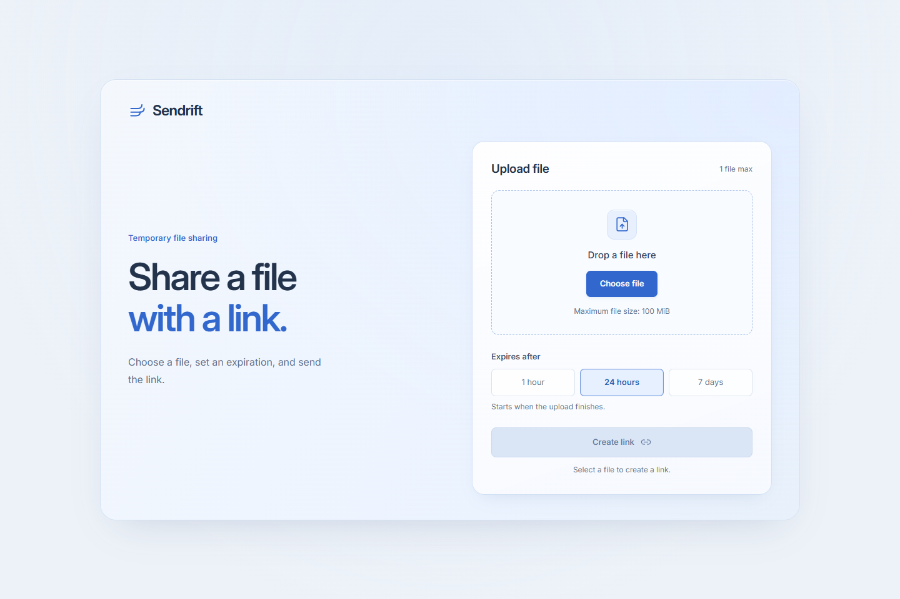
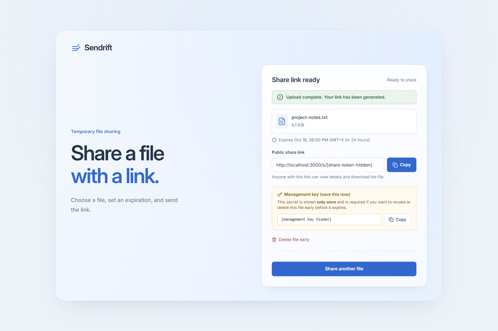
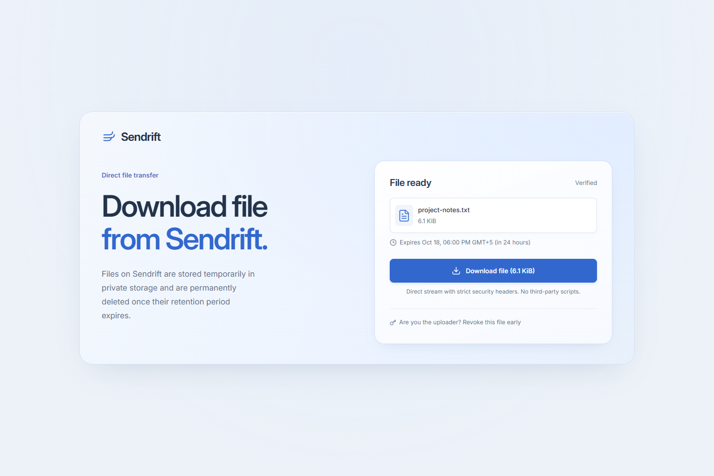
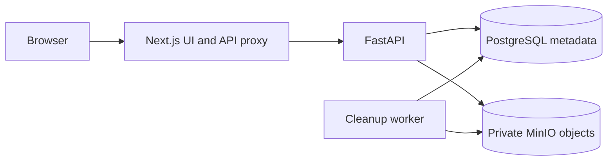

# Sendrift

A temporary file-sharing application built with Next.js, FastAPI, PostgreSQL and private S3-compatible storage. Upload one file, choose an expiration, and share a link. A separate management key lets the sender revoke access early.

Sendrift is a portfolio project that runs locally with Docker Compose. It is not intended to be operated as a public file-hosting service.



## Features

- Single-file uploads from **1 byte to 100 MiB**, with a file picker, drag and drop, and real upload progress.
- Expiration after **1 hour, 24 hours or 7 days**, starting when the upload completes.
- A recipient page with file details and downloads streamed through the API as attachments.
- A separate, one-time-issued management key for revoking a link. No account required.
- Server-side expiration and revocation checks, independent of the cleanup schedule.
- A cleanup worker for expired files, failed uploads and interrupted operations, with retryable deletion.

There is no email transfer, folder upload, file preview, resumable upload or account system.

## Screenshots

Captured from the running local application using a synthetic file. The share token and management key in the upload result are redacted.

### Upload result



### Recipient view



## Stack

| Part | Technologies |
| --- | --- |
| Frontend | Next.js 14, React 18, TypeScript, Tailwind CSS |
| API | Python, FastAPI, Pydantic, SQLAlchemy |
| Metadata | PostgreSQL 16, Alembic migrations |
| File storage | Private MinIO bucket through the S3 API, boto3 |
| Cleanup | Python worker using the API's services and repositories |
| Local runtime | Docker Compose |
| Checks | pytest, Ruff, TypeScript, ESLint, Node test runner |

## Architecture



Next.js serves the UI and proxies same-origin `/api/*` and `/health/*` requests to FastAPI. The API owns validation, authorization and file lifecycle rules. PostgreSQL stores metadata and SHA-256 hashes of independently generated 256-bit share and management tokens; file bytes stay in MinIO.

Uploads use temporary file spooling and bounded S3 transfers. A link is returned after both the object write and the database commit succeed. This does not imply constant memory usage across the Next.js proxy or an aggregate resource limit.

Revocation blocks new access immediately; physical deletion happens asynchronously. The worker runs every 60 seconds by default and retries failed cleanup. Orphan reconciliation is implemented but **not enabled** in the default Compose command. Expired links stop working even if the worker is unavailable. A download already in progress is not guaranteed to stop when its link expires or is revoked.

```text
apps/web/             Next.js UI, proxy configuration and frontend checks
apps/api/app/         FastAPI routes, services, repositories, storage and worker
apps/api/migrations/  Alembic schema migrations
apps/api/tests/       Unit tests and opt-in integration tests
compose.yaml          Main local development configuration
infra/                Alternate Compose entry point and an unused Nginx example
docs/screenshots/     Screenshots using synthetic data
```

See [ARCHITECTURE.md](ARCHITECTURE.md) for transaction boundaries, state transitions and API contracts.

## Run locally

Requirements: Git, Docker Engine or Docker Desktop, and Docker Compose v2. Run from the repository root:

```sh
git clone https://github.com/alastrm/Sendrift.git
cd Sendrift
cp .env.example .env
docker compose build
docker compose up -d postgres minio
docker compose run --rm api alembic upgrade head
docker compose up -d
```

In PowerShell, `Copy-Item .env.example .env` also works. On an existing checkout, keep your existing `.env`; do not overwrite it. The template contains public development credentials, suitable only for this local demo.

Migrations are explicit; API startup does not apply them. Startup creates the configured bucket if missing and checks its privacy. Keep existing PostgreSQL credentials when reusing a data volume: changing `.env` does not change the database's stored password.

| Service | Local address |
| --- | --- |
| Application | [localhost:3000](http://localhost:3000) |
| API readiness through Next.js | [localhost:3000/health/ready](http://localhost:3000/health/ready) |
| Development API docs | [localhost:8000/docs](http://localhost:8000/docs) |
| PostgreSQL | `127.0.0.1:5433` by default (`POSTGRES_PORT`) |
| MinIO S3 API | `127.0.0.1:9000` |
| MinIO console | [localhost:9001](http://localhost:9001) |

All published ports bind to `127.0.0.1`. Containers use internal service names and ports. Readiness checks database/storage connectivity; it does not verify that migrations are current.

```sh
docker compose ps
docker compose logs --tail=50 worker
docker compose stop
```

The worker has no HTTP server, so its inherited HTTP healthcheck is disabled. Check cleanup logs and the integration smoke test for evidence that it is doing work. Use `up -d`, rather than waiting for a healthcheck on every service.

PostgreSQL and MinIO use named volumes. `stop` and `down` preserve them; `down -v` removes stored data. No Nginx container is needed locally; `infra/proxy/nginx.conf.example` is an incomplete reference, not a production configuration.

### Frontend development outside Docker

Keep the backing services and API running in Compose, then stop the web container to free port 3000:

```sh
docker compose stop web
cd apps/web
npm ci
npm run dev
```

The local Next.js proxy defaults to `http://localhost:8000`. Override it in `apps/web/.env.local` with `INTERNAL_API_URL`. Production rewrites are fixed at build time: Compose builds with `http://api:8000`, and changing only a running web container's environment does not update them. `PUBLIC_WEB_URL` controls generated share-link origins separately.

## Tests

### API unit tests and lint

From `apps/api`, create and activate a Python virtual environment, then install the development requirements:

```sh
python -m venv .venv
# Linux/macOS: source .venv/bin/activate
# PowerShell: .\.venv\Scripts\Activate.ps1
python -m pip install -r requirements-dev.txt
python -m pytest -q
python -m ruff check .
```

Tests needing real services are skipped by default. Unit tests use test doubles; they do not establish PostgreSQL or S3 correctness on their own.

### Frontend checks

From `apps/web`, after `npm ci`:

```sh
npm run typecheck
npm run lint
node --test tests/proxy-config.test.mjs
npm run build
```

### Running-stack integration smoke test

With Compose running and migrations applied, use the API virtual environment from `apps/api`:

```sh
# Linux/macOS
SENDRIFT_DOCKER_SMOKE=1 python -m pytest -q tests/test_docker_proxy.py
```

```powershell
# PowerShell
$env:SENDRIFT_DOCKER_SMOKE = "1"
python -m pytest -q tests/test_docker_proxy.py
Remove-Item Env:SENDRIFT_DOCKER_SMOKE
```

This checks the built proxy, readiness, real upload/download round trips for 1 byte, 1 MiB and 100 MiB, database metadata, anonymous S3 denial, revocation and eventual worker deletion. It revokes only its own synthetic fixtures. Allow time for the worker's next cycle.

The broader `test_real_*.py` suite requires `SENDRIFT_REAL_INTEGRATION=1` and **disposable PostgreSQL/MinIO test resources** configured for the host-running test process. It exercises migrations, bucket policies, cleanup and concurrency, and can alter configured test resources. Do not enable it against a database or bucket containing files you want to keep. The root environment template uses Docker hostnames; host-running integration tests need host-reachable database URLs and `S3_ENDPOINT_URL`.

## Status and limitations

The local upload → link → download → revoke → cleanup workflow is implemented. This is a portfolio demonstration, with no public deployment or service operation planned.

- Anonymous upload has no aggregate quotas, rate limiting or operational abuse response. Do not expose this stack to untrusted networks.
- Files are not scanned for malware and are not end-to-end encrypted. The recipient page's “Verified” label denotes an available file, not a security scan.
- Expiration denies access immediately; physical removal depends on successful cleanup and can be delayed by failures.
- Anyone holding a share link can access the file until expiration or revocation. A lost management key cannot be recovered through the UI.
- Dependency and proxy logging issues recorded in [SECURITY_AUDIT.md](SECURITY_AUDIT.md) remain outstanding. That report evaluates Internet deployment, not publication of the source as a local demo. Dependencies have not been upgraded for portfolio preparation.
- Image tags and Python dependency ranges are not fully pinned. A fresh build can resolve different images or Python packages.

## Project notes

- [CONTEXT.md](CONTEXT.md): project scope and intended behavior.
- [ARCHITECTURE.md](ARCHITECTURE.md): implementation and design decisions.
- [AGENTS.md](AGENTS.md): engineering rules.
- [Repository review](docs/repository-review.md): publication hygiene checks and their limits.

The bundled Inter font includes its [license](apps/web/public/fonts/Inter-LICENSE.txt). A license for the application source has not been selected; public visibility alone does not grant a general right to reuse it.
